# Sentin8:AI - Detailed Design Document

## 1. Scope & Context

Sentin8:AI owns the platform's AI plane: prompt assets (versioned,
immutable), provider routing (openai / anthropic / ollama / vllm adapters
with normalised tool-call support), synchronous inference (buffered +
streamed), **multi-turn agent conversations with a bounded tool-calling
loop**, vector + keyword retrieval, async AI jobs (embeddings, summaries,
classifications, document pipelines), budgets, evaluations, output
filters, traces/costs, and its dead-letter queue.

- **Owns** (schema `ai`, database `sentin8`): `prompts`, `providers`,
  `embeddings`, `traces`, `embedding_registry`, `dlq`, `budgets`,
  `evaluations`, `filters`, and the **agent plane** - `agents`, `tools`,
  `conversations`, `messages`, `runs`, `tool_calls`, `approvals`,
  `agent_policies` - plus `outbox` (DBX) and `audit_journal` (DBX); the
  stream family `ai`; the three direct-consumer groups on it.
- **Does NOT own**: model credentials (secret **references** resolved via
  Sentin8:Secrets / env backend), **long-running side effects** of agent
  tools (Sentin8:Flow workflows, Sentin8:Func modules), scheduling
  (Sentin8:Cron), document blobs (Sentin8:Storage), spend analytics
  (Sentin8:Stat), identity issuance (Sentin8:Auth - AI only *requests*
  agent tokens).
- **Agent plane boundary**: the model loop (context assembly, provider
  iteration, tool dispatch, guards) is AI's. The work a tool performs
  belongs to the owning service and is reached through the tool gateway
  (`sys.service_actions`, Flow, Func) - AI never reads another service's
  tables and never executes domain logic itself.

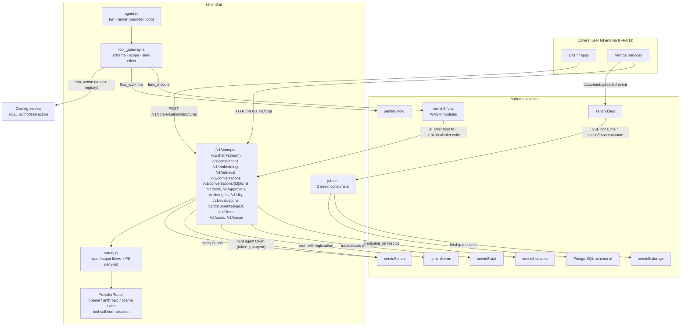

## 2. Runtime Architecture

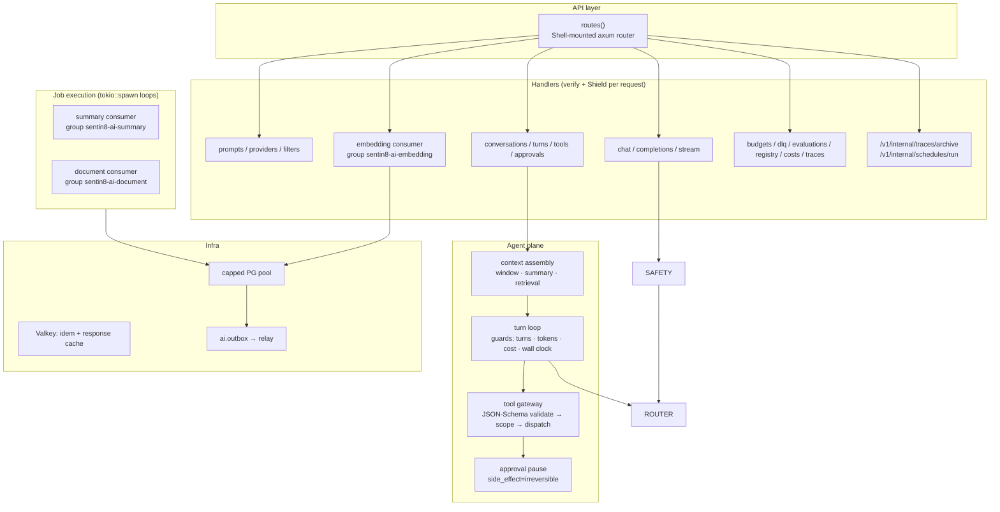

**Request lifecycle - buffered inference (`POST /v1/chat`):**

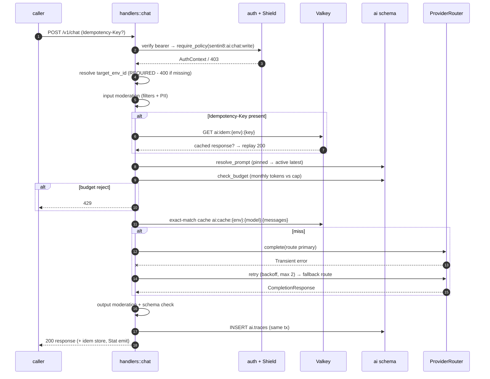

Error branches: terminal provider error (4xx/auth/schema) → 422; retries
exhausted → 502; moderation failure → 422 with filter name.

**Request lifecycle - one agent turn (`POST /v1/conversations/{id}/turns`):**

A turn is the unit of multi-turn behaviour: it appends the user message,
runs the bounded loop, persists every tool exchange, and returns the final
assistant message. Everything the loop decided is recorded, so a turn is
reproducible from `ai.runs.context_plan`.

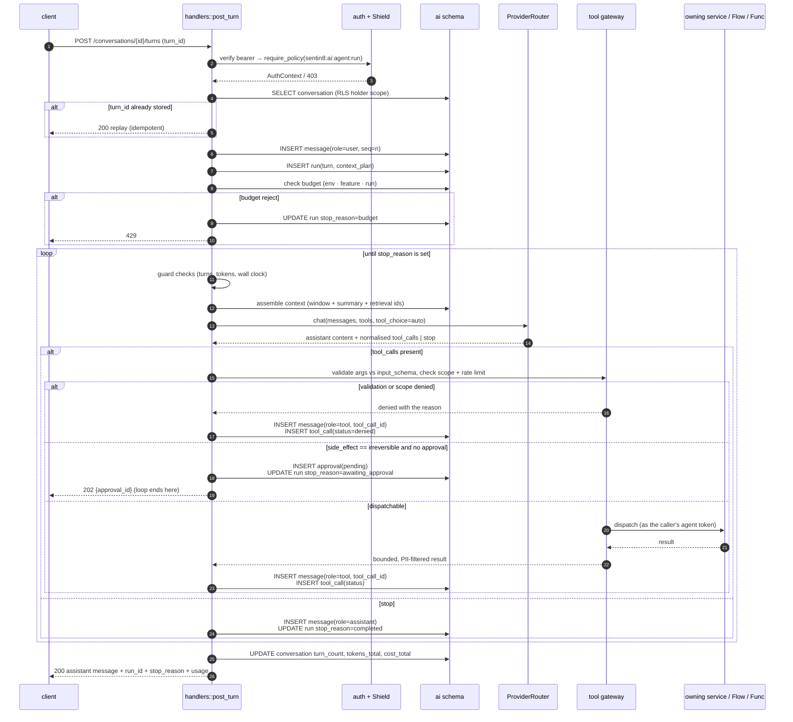

Loop guards are mandatory and each one is recorded on the run:
`max_turns` (agent policy), token + cost budget (decremented before each
provider call), and a wall-clock deadline for the whole turn. Stop reasons
are a closed set: `completed`, `max_turns`, `budget`, `cancelled`,
`awaiting_approval`, `error`.

## 3. Data Model

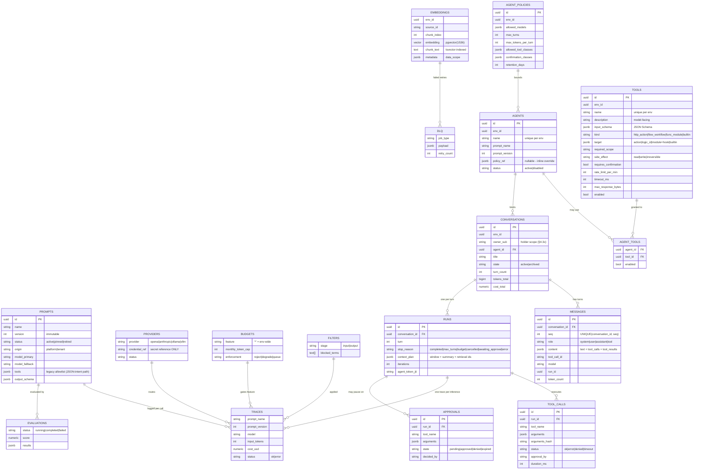

- **RLS**: every table `ENABLE`+`FORCE`, per-op policies keyed on
  `sentin8_current_env_id() = env_id`; outbox/journal policies additionally
  require `sentin8_context_initialized()`.
- **Holder-scoped RLS on conversations** (§4.3c): `ai.conversations`
  select/update admit the `owner_sub` row only (plus env/org admins
  through the context-stamped flags). `ai.messages`, `ai.runs`,
  `ai.tool_calls` and `ai.approvals` inherit the scope through their
  parent conversation - a policy that joins the parent is the only
  permitted shape; there is no org-wide visibility tier on agents.
- **`ai.tools` and `ai.agents` are tenant-authorable** (`origin`-less:
  every row is tenant-owned; the platform seeds none). `ai.agent_policies`
  is the per-env bounds document (models, turn caps, tool classes,
  retention) - an agent's effective policy is its referenced policy or
  the env default.
- **`ai.traces` gains `run_id`** so an inference is attributable to the
  turn that caused it; the conversation key never lives on the trace
  (the trace stays a metrics row).
- **Secrets**: `providers.credential_ref` holds a secret *reference* -
  material never lands in application tables (resolved via Secrets or the
  env backend `SENTIN8_AI_PROVIDER_KEY_*`).
- **Indexes**: HNSW cosine on `ai.embeddings.embedding` (pgvector-guarded),
  GIN on `to_tsvector('simple', chunk_text)`, partial unrelayed indexes on
  `outbox`/`audit_journal`; helper `ai.ai_monthly_tokens(env, feature)`;
  `UNIQUE (conversation_id, seq)` on `ai.messages` (turn ordering and
  idempotent append), `UNIQUE (env_id, name)` on `ai.tools` and
  `ai.agents`, partial `ai.approvals_pending_idx` on `(run_id)
  WHERE state='pending'`.

**Prompt lifecycle:**

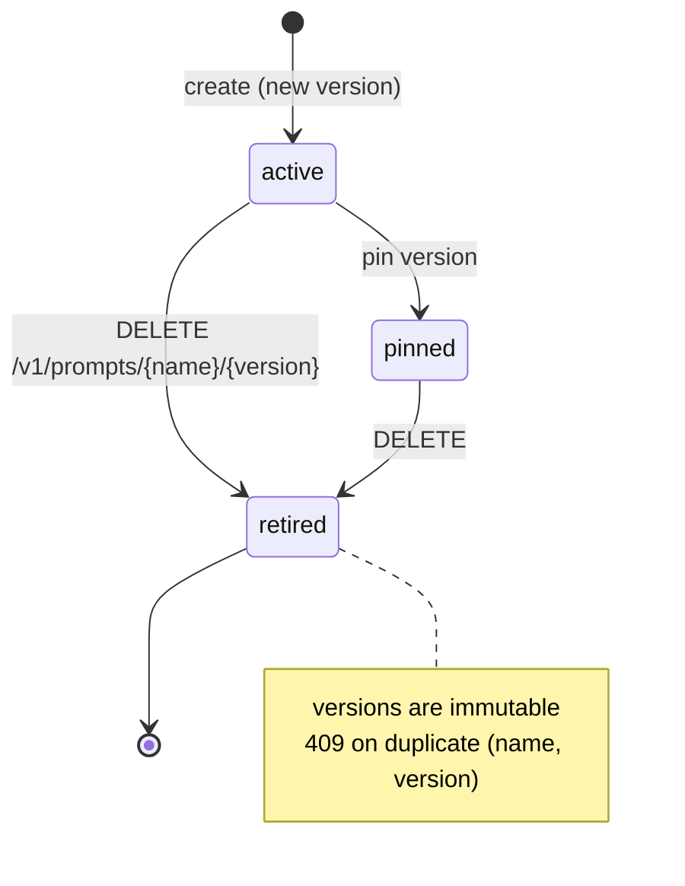

**Agent plane lifecycles:**

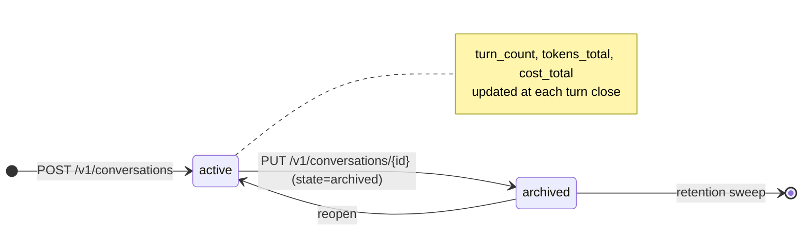

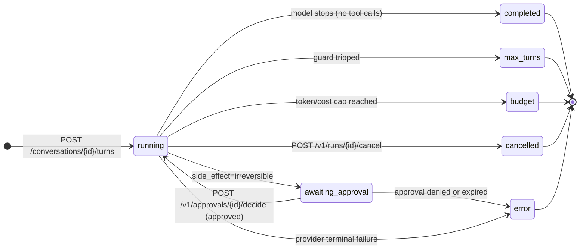

- **Run records are append-only** apart from the terminal `stop_reason`
  and usage counters. A resumed approval never rewrites history: it opens
  the next iteration of the same run so the transcript stays linear.

## 4. API Surface

### 4.1 Endpoint groups

Groups (every route: bearer verify → Shield `require_policy`, target env
required for data surfaces, no in-handler scope checks):

| Group | Endpoints | Gate action | Events |
|-------|-----------|-------------|--------|
| prompts | `POST/GET /v1/prompts`, `DELETE /v1/prompts/{name}/{version}` | `ai:prompt:write` / `ai:prompt:read` | `sentin8:ai:prompt:updated` |
| inference | `POST /v1/chat`, `/v1/completions`, `/v1/chat/stream` (ndjson) | `ai:chat:write` / `ai:completion:write` | trace rows + Stat |
| vectors | `POST /v1/embeddings`, `POST /v1/retrieval`, `/v1/documents/ingest`, `GET/PUT /v1/registry` | `ai:embedding:write` / `ai:retrieval:read` | `sentin8:ai:document:ready` |
| ops | `/v1/budgets/{feature}`, `/v1/dlq[/replay]`, `/v1/evaluations/run`, `/v1/costs`, `/v1/traces` | prompt scopes | `sentin8:ai:{job_type}:job` (replay) |
| conversations | `POST/GET /v1/conversations`, `GET /v1/conversations/{id}`, `PUT /v1/conversations/{id}`, `GET /v1/conversations/{id}/messages?after_seq=` | `ai:conversation:read` / `ai:conversation:write` | `sentin8:ai:conversation:created`, `:archived` |
| turns | `POST /v1/conversations/{id}/turns`, `GET /v1/runs/{id}`, `POST /v1/runs/{id}/cancel` | `ai:agent:run` | `sentin8:ai:run:completed`, `sentin8:ai:turn:delta` (SSE) |
| tools | `POST/GET /v1/tools`, `GET /v1/tools/{name}`, `PUT/DELETE /v1/tools/{name}` | `ai:tool:read` / `ai:tool:write` | `sentin8:ai:tool:updated` |
| agents | `POST/GET /v1/agents`, `PUT/DELETE /v1/agents/{name}`, `POST/GET /v1/agent-policies` | `ai:agent:write` / `ai:agent:read` | `sentin8:ai:agent:updated` |
| approvals | `GET /v1/approvals?state=pending`, `POST /v1/approvals/{id}/decide` | `ai:agent:approve` | `sentin8:ai:approval:decided` |
| internal | `/v1/internal/traces/archive` (Cron proxy-back), `/v1/internal/schedules/run` (stale re-embed scan) | `ai:embedding:write` | archive events |
| admin/RFW | `/v1/admin/ui/{page}`, `/v1/admin/{resource}`, shared policy admin | Shield | - |
| health | `GET /v1/health` | none | - |

**Event flow (outbox → Bus → trigger):**

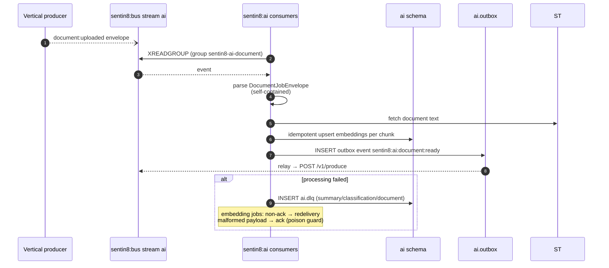

Registration-declared triggers: `*:document:uploaded` → document-pipeline;
`sentin8:ai:trace:archive` (cron `ai-trace-archive`); 
`sentin8:ai:embedding:stale` (cron `ai-reembed-stale`);
`sentin8:ai:agent:turn_requested` → `{"kind": "agent", "agent_name": ...}`
(an inbound event opens a turn instead of a job).

### 4.2 Tool gateway contract

A tool is a tenant-authored row, not a code path. Dispatch is uniform, so
adding a capability never edits AI:

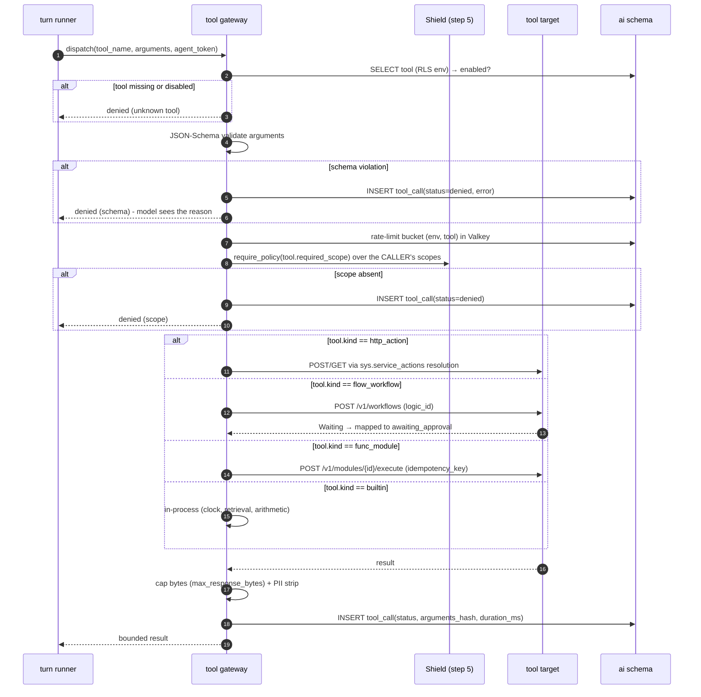

- **`http_action` resolves through `sys.service_actions`** - the same
  registry the BFF's `/bff/action/{action}` uses. No URL is ever stored on
  a tool row; the tool names an action, enroll published the mapping.
  This also gives discovery for free: the candidate tool set for an env is
  the actions its scopes admit.
- **`side_effect`** is the confirmation axis: `read` and `write` execute
  inline; `irreversible` always pauses for `POST /v1/approvals/{id}/decide`
  before dispatch. The class is on the tool row, so a tenant can declare
  their own tool irreversible.
- **`rate_limit_per_min` is enforced at the gateway**: a fixed one-minute
  `INCR`/`EXPIRE` window keyed `(env, tool)` in Valkey (ai `rate_limit.rs`),
  with a process-local minute window as the degraded mode - a Valkey outage
  tightens to the local bound, it never fails open and never blocks a tool
  outright. A refused call is a model-visible `denied` with the reason.
- **Tool results are sanitized before they re-enter the transcript**: capped
  to the row's `max_response_bytes`, then deny-list PII keys are removed
  RECURSIVELY (a tool result nests; the shared top-level `strip_pii` used by
  traces is not enough for this path). The sanitizer is `sanitize_tool_result`
  in `agent_gateway.rs`, pinned by an integration test.
- **Approval EXECUTES the tool**: an approved decision reopens the run,
  re-validates the arguments and the APPROVER's scope (approval never
  bypasses the gates), dispatches under the approver's authorization, appends
  the sanitized result to the transcript, and re-closes the run. A denial
  fails it. The decision commits first, so an approval is never re-decidable.
- **Arguments never reach a target unvalidated.** The schema check happens
  in the gateway, not in the target, and `arguments_hash` lands in audit so
  a mutation is provable after the fact.
- **Results are bounded and filtered before they re-enter the transcript**:
  `max_response_bytes` truncation plus the env PII deny-list, so a large or
  sensitive tool payload cannot bloat context or leak into a message row.
- **Tool execution authority is the caller's**, never AI's: the agent token
  carries the conversation owner plus the `act` chain (see §5), and Shield
  evaluates it. A tool cannot escalate beyond what the requesting user
  could do directly.

### 4.3 Provider tool-call normalisation

The adapters convert each provider's native shape into one `ToolCall`
(`{id, name, arguments}`) plus a normalized `FinishReason`
(`stop | tool_calls | length | content_filter`):

| Provider | Request | Response |
|---|---|---|
| OpenAI / vLLM / Ollama | `tools[]` + `tool_choice` | `choices[].message.tool_calls[]`, `finish_reason` |
| Anthropic | `tools[]` (added - the body previously had none) + `tool_choice` | `content[]` blocks of `type: "tool_use"` (`id`, `name`, `input`), `stop_reason` |
| Assistant echo | `role: tool` + `tool_call_id` replayed as the provider expects (`tool` role on OpenAI family, `tool_result` block on Anthropic) | - |

The JSON-intent contract (`{action, params, requires_confirmation}`) is
retained as an explicit **JSON-output mode** for deterministic
classification prompts - a prompt may declare it, and `parse_intent`
remains the fail-closed parser for that mode. It is no longer the only
path: the default agent path is native tool calling.

### 4.4 Edge-function inference (`ai_infer`)

Sentin8:Func modules reach inference through a host builtin that AI
serves on its normal inference surface - no per-service passthrough
endpoint exists anywhere in the platform.

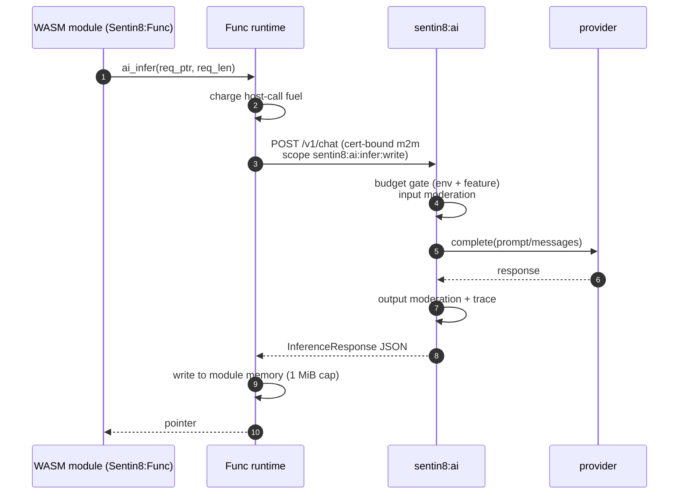

- **Identity is the module's workload certificate**, not the caller's
  bearer: the Func runtime holds a `sentin8:ai:infer:write` grant (narrower
  than `chat:write` - inference only, no prompt or tool administration).
- **Multi-turn inside a stateless sandbox**: the request may carry
  `conversation_id`; AI loads history, runs the turn, and persists it. The
  module stays fuel-bounded and state-free, which is the only shape the
  sandbox permits.
- **The module cannot outspend its env**: AI's budget gate applies
  unchanged, and the model choice comes from the env's provider routes
  (§4.4), not from anything the module sends.
- **Bounded**: the same 1 MiB response cap as every proxy-back, and a
  provider timeout that aborts the host call rather than the module
  (the module sees an error and decides).

### 4.5 Provider routes are tenant-scoped and live

Routes resolve per request from the caller's env, not from a boot-time
snapshot of `sys/ops`:

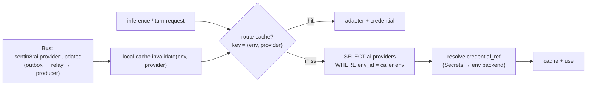

- A tenant registering `ai.providers` takes effect on the next request.
  `put_provider`/`delete_provider` write an outbox row
  (`sentin8:ai:provider:updated`) in the same transaction and invalidate the
  local entry, so the change is immediate on the writing instance and
  propagates to the fleet through the Bus relay; the `(env, provider)` cache
  entry also expires on its 5-minute TTL as the backstop for a missed
  event.
- Credential resolution stays secret-reference-only; the cache holds the
  resolved adapter and a short-lived credential, never plaintext at rest.
- An env with no provider row falls back to the platform (`sys/ops`) route
  only for platform-origin prompts; a tenant prompt with no tenant route is
  a 422 naming the env, never a silent platform charge.

## 5. Cross-Cutting Concerns

- **Auth**: every route `verify_bearer_token` → Shield `require_policy`
  (live roles/scopes from auth); step 5 is the only gate - no handler
  scope checks.
- **Tenant resolution**: `target_env_id` query REQUIRED on admin/data
  endpoints (no fallback to token env - rejects with 400).
- **RLS context**: transaction-local `sentin8_set_tenant_context` on the
  caller's env inside each write transaction; trace insert shares the
  request's transaction.
- **Idempotency**: `ai:idem:{env}:{key}` (24h TTL) replays full response
  for retried inference calls; job consumers dedupe on `job_id`. A turn is
  idempotent on the caller-supplied `turn_id` (a partial unique index on
  `(conversation_id, turn_id) WHERE role='user'`): a retried turn returns the
  stored assistant message instead of appending a second one.
- **Turn serialisation is structural**: `ai.runs` carries
  `UNIQUE (conversation_id, turn)`, so a concurrent duplicate turn is
  rejected by the index (409) rather than by a lock some path forgets to
  release. There is no advisory lock in the turn path.
- **The loop runs in SHORT transactions**: setup, each provider iteration,
  each tool dispatch, and the close each commit separately - a crash loses
  at most the in-flight provider call, never a partial transcript.
- **Moderation**: input stage before provider call; buffered output stage
  after; streaming moderation on an accumulated buffer per delta
  (mid-stream violation aborts with an error frame). Agent turns moderate
  **both directions of every hop**: the user message on entry, each
  assistant message on arrival, and each tool *result* before it re-enters
  the transcript - a tool returning injected text is the primary
  prompt-injection channel in an agent loop.
- **Budgets**: env-wide `'*'` fallback + per-feature caps; `reject` →
  429, `degrade`/`queue` → cost-labelled traces (`{feature}:cost-{mode}`).
  A turn charges `feature = agent:{agent_name}` and the env `'*'` budget;
  the check runs before each provider call inside the loop, so a long
  tool chain cannot overspend a cap it already crossed.
- **Agent identity**: each run mints a short-lived token from Sentin8:Auth
  - `token_tp: "agent"`, `sub` = the conversation owner, `act` =
  `{agent_name, conversation_id, run_id}` - cert-bound where the caller is
  a service. The run stores the `jti`, so audit can revoke or trace a
  single run. The act chain is *claims*, not a hand-built array.
- **Audit journaling**: agent runs, tool calls, approvals, DLQ writes, and
  every inference land in `ai.audit_journal` (pushed to the shared audit
  ingest). A tool call row carries `run_id`, `tool_name`,
  `arguments_hash`, `status`, `approval_by`, `duration_ms` - enough to
  reconstruct what the agent did without replaying the model. The
  inference row carries cache provenance - `cache: "hit"|"miss"` plus the
  prompt-hash key - so a replay is distinguishable from a fresh
  generation.
- **Context assembly is recorded, not implicit**: `runs.context_plan`
  stores the window boundary, the summary message id (when history was
  summarised), and the retrieval chunk ids that were injected. Two runs of
  the same turn over the same history produce the same plan, which is what
  makes an agent turn reproducible and auditable.
- **Retention**: `ai.agent_policies.retention_days` bounds conversation
  history; the sweep archives messages beyond the window into Storage and
  keeps the conversation skeleton (the same archive pattern as traces).
- **Graceful drain**: shell-owned graceful shutdown; relay fail-open. An
  in-flight turn finishes or fails with `stop_reason=error`; it never
  leaves a half-written transcript because messages and the run update
  commit together.

## 6. Failure Modes & Recovery

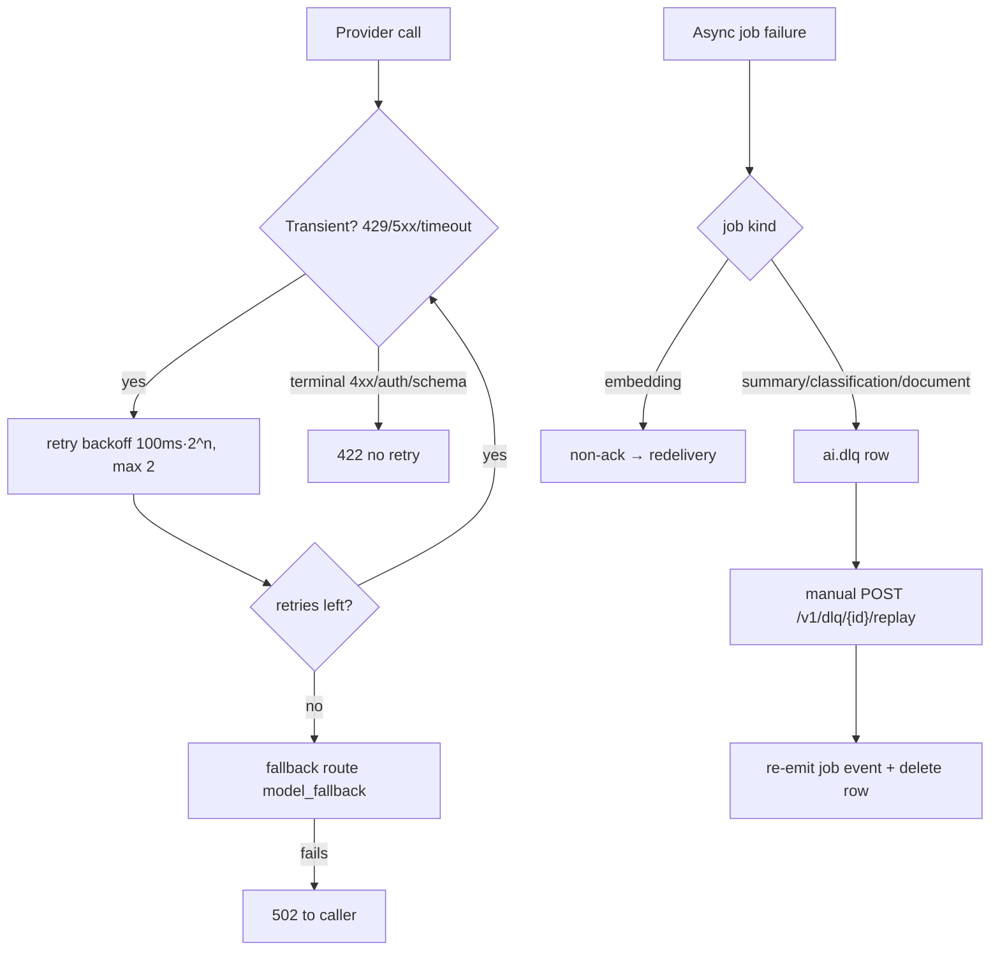

- **Valkey down**: idempotency + cache degrade to direct execution
  (best-effort paths never fail the request). The tool rate-limit bucket
  degrades to process-local counting - a Valkey outage weakens rate
  limiting, it never blocks tool execution.
- **Bus down**: outbox relay persists rows in `ai.outbox` (5s safety
  poll); consumer loops retry their connections.
- **Stat/Flow/Cron/Storage outages**: log-only degradations (trace row
  still carries spend; a `flow_workflow` tool returns `error` while the
  turn continues; cron registration skipped; archive retains hot rows).
- **Credential loss**: secret ref unresolvable → provider disabled at
  routing time (422 to caller or `stop_reason=error` inside a turn, no
  crash loop).

**Agent-loop failure paths:**

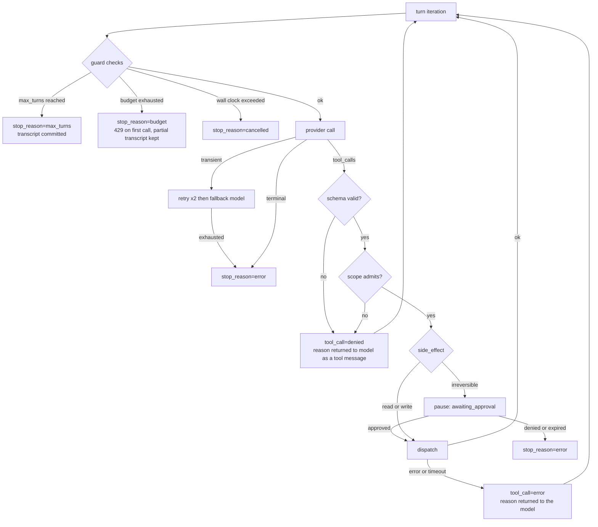

- **A failing tool does not fail the turn.** The error becomes a tool
  message so the model can recover, change approach, or explain. The turn
  fails only when the model cannot continue (provider terminal, guards).
- **A denied tool is a model-visible fact**, not a silent drop: the model
  sees `denied: <reason>` and the audit row carries the same reason. A
  silent drop makes an agent loop look like it succeeded when it did not.
- **Crash mid-turn**: the run row holds `stop_reason` unset and the last
  committed message seq; the next request resumes context from the last
  committed seq. Committing messages and the run update in one transaction
  bounds the loss to the in-flight provider call.
- **Approval expiry**: a pending approval past its deadline transitions to
  `expired` and the run to `error` - an agent never parks forever.

## 7. Concurrency & Performance Model

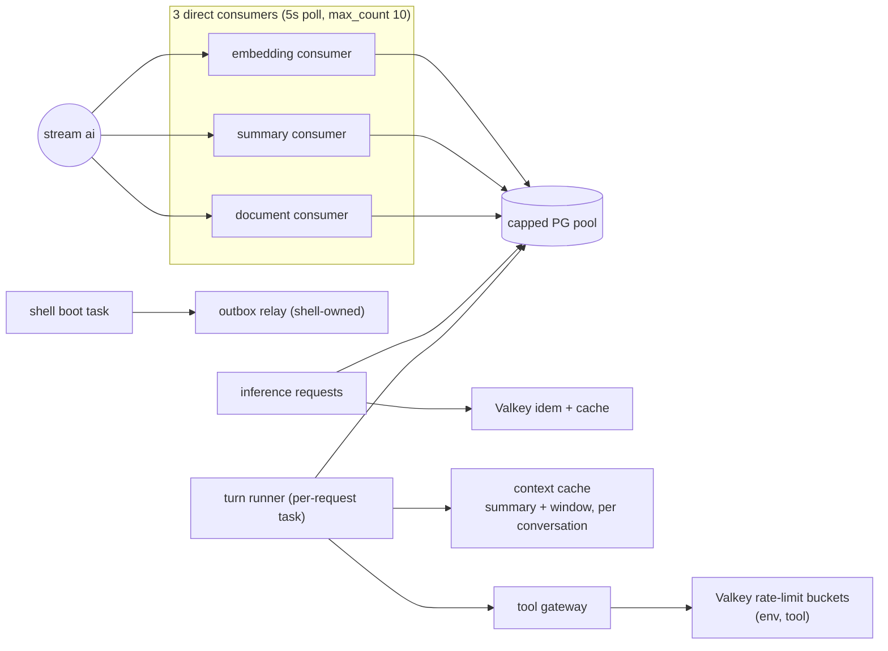

- **Turns are not background tasks.** A turn runs inside its request (bounded
  by the wall-clock guard), so no unbounded tokio task is spawned per
  conversation and a crashed instance loses at most one in-flight call.
- **One turn per conversation at a time**: an advisory lock keyed
  `(env_id, conversation_id)` serialises concurrent turn requests, which is
  what makes `seq` assignment and `turn_count` correct under retries.
- **Tool dispatch is sequential within a turn.** Parallel tool execution is
  deliberately not done: the transcript ordering must stay deterministic and
  an irreversible tool must not race a read.
- Pool capped (`sentin8_config::pg_pool::connect`, max 3 default) -
  inference trace writes, job upserts and turn commits share the cap; the
  budget check runs once per provider call inside the loop.
- Retrieval `top_k` clamped 1-100; archives bounded (`LIMIT 10000`);
  trace lists 1-500; DLQ listing 200; message pages 1-200 (default 50).
- Hot paths cached: exact-match response cache (1h TTL; the key covers env,
  model, messages, temperature, max_tokens, and the tool set - hashed to a
  bounded sha256 prompt-hash, so a near-hit can never replay a response
  generated under different sampling params) - **bypassed for conversation
  turns**, because a dialog key never repeats and a hit would replay a
  stale answer; embeddings via HNSW; keyword via GIN tsvector.

## 8. Invariants, Insecure-Defaults Rejected, Unsafe Rationale

1. **Prompt versions immutable** - an update creates a new version; 409 on
   duplicate `(env_id, name, version)`; `origin platform` rows are
   enroll-owned, `tenant` rows never touched by enroll.
2. **`target_env_id` REQUIRED** on data endpoints - no silent fallback to
   the token env (cross-tenant read guard).
3. **Credential references only** - provider keys never stored in
   `ai.providers`; resolution order: Secrets ref → env backend.
4. **Filters run both directions** (input + output) with a persistent PII
   deny-list; output moderation cannot be skipped by model_override.
5. **Budget checks precede provider spend** - a rejected request never
   reaches a provider.
6. **DLQ replay is manual** - failed jobs never auto-retry past the
   consumer redelivery; malformed payloads are acked (poison-pill guard).
7. Traces insert in the same transaction as the response decision - a
   trace row exists for every completed or failed inference.
8. No `unsafe` blocks in the service.
9. **The model never executes.** It emits tool calls; the gateway validates
   the arguments, checks the scope, applies the confirmation class, and only
   then dispatches. There is no code path from model output to execution that
   skips the gateway.
10. **Conversation history lives only in AI.** No Func module, Flow workflow,
    or client holds authoritative transcript state; each addresses a
    conversation by id. History is therefore bounded, auditable, and
    tenant-deletable in one place.
11. **Every loop is bounded and the bound is recorded** - `max_turns`, token +
    cost budget, wall-clock deadline. A turn always terminates with a stop
    reason from the closed set.
12. **No tool executes on an unvalidated argument set**, and every executed
    call carries `arguments_hash` in audit.
13. **Tool authority is the caller's**, never AI's: the per-run agent token
    carries the owner and the act chain, and Shield evaluates it. AI holds no
    scope that a tool target honours on its own behalf.
14. **A tool result is re-moderated before it enters the transcript** - tool
    output is untrusted model input and is the primary injection channel.
15. **Turns bypass the exact-match cache**; prompt-only inference keeps it.

## 9. Testing Strategy

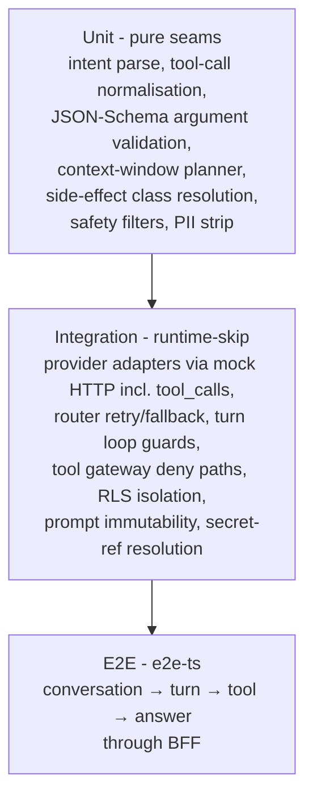

- `tests/integration.rs`: adapters (openai/anthropic/ollama/vllm mock
  round-trips **including tool-call responses**), error taxonomy (429
  transient, 401 terminal), retry + fallback routing, DB RLS isolation,
  version immutability, filter load per env, chunk persistence,
  credential-ref resolution, registration identity/scopes, policy boot.
- Agent suite (same file, DB-gated): a multi-iteration turn against a
  scripted mock provider (model calls a tool, receives the result, answers);
  each guard tripping to its expected stop reason; schema-invalid arguments
  denied without dispatch; out-of-scope tool denied; `irreversible` tool
  pausing then resuming on approval; `turn_id` replay returning the stored
  message; conversation visibility isolation between two users in one env.
- Deliberately not unit-tested: provider HTTP correctness (mocked), Stat
  emission, cron registration (e2e/platform layer), real model quality
  (that is the evaluations surface).

## 10. Open Questions

- SSE transport for `POST /v1/chat/stream` is already aligned: the transport
  rule (principles §4.7a) governs, not a per-endpoint choice.
- Token-accurate streaming accounting adopts the approximation the
  normalization already performs (estimate from the terminal frame).
- Embedding model versioning is live (AI-2): `ai.embeddings.model_version`
  stamps every write with the registry-active version (`ai_version_for`);
  the Cron `model_migration` sweep (`POST /v1/internal/schedules/run`)
  re-enqueues jobs for rows trailing the registry - the dual-read
  discriminator. Per-model DIMENSIONS remain a pgvector-typmod concern:
  changing the pinned dimension is a greenfield re-init (the registry row
  + version sweep govern which rows are current).
- **Context compression strategy is deliberately coarse**: a conversation
  beyond the model window is summarised once at a recorded boundary rather
  than continuously re-summarised. Token-exact budgeting per model family
  is deferred; the guard uses provider-reported usage where available and
  the existing char/4 estimate otherwise (`usage_estimated` flags it).
- **Parallel tool execution** is not implemented. If a concrete workload
  needs it, it must arrive with a deterministic transcript ordering rule
  (a batch id per assistant message) rather than ad-hoc concurrency.
- **Multi-agent orchestration** (an agent delegating to another agent) is
  out of scope here: it composes as a tool of kind `flow_workflow` whose
  logic calls `POST /v1/conversations/{id}/turns`, which keeps one
  transcript owner per conversation and avoids nested-loop guard
  ambiguity. If that proves insufficient, the design change is an explicit
  `sub_agent` tool kind with a shared budget tree - not a new execution
  engine.
- **Model routing per turn** (cheap model for tool selection, strong model
  for synthesis) is expressible today as a per-prompt `model_primary` on
  different prompts; a first-class per-iteration routing policy is deferred
  until a tenant asks for it.

---

**Architecture & Design:** sentin8:ai and its underlying concepts were designed by [Hamid Jahanzad](https://www.linkedin.com/in/hamidjahanzad/).
