# Design Doc: Sentin8:AI - Platform AI Capability Layer

## 1. Summary

Sentin8:AI is the platform's AI capability layer: a prompt registry with
versioning, inference primitives (completion, chat, streaming, embeddings)
routed over a pluggable model-provider layer, permission-filtered hybrid
retrieval, and a **multi-turn agent plane** - conversations with persisted
transcript, native tool calling, a tenant-authorable tool registry, and
bounded runs with human approval for irreversible actions. It also owns
token budgets with cost gating and full observability (traces, Stat
metrics, cost rollups). Provider credentials are secret references
resolved at call time - never stored material.

## 2. Motivation

- **One AI surface for every vertical.** Verticals need completions,
  chat, embeddings, and retrieval without each embedding an SDK stack.
  Sentin8:AI centralizes the prompt lifecycle, provider routing, safety
  filtering, cost accounting, and audit behind one Shield-gated API.
- **Providers change; contracts don't.** Model vendors and their APIs
  churn (OpenAI, Anthropic, Ollama Cloud/Hosted, future providers). The
  adapter boundary isolates that churn behind two traits while the rest
  of the platform codes against prompt id + inference request/response.
- **Model output is untrusted, and must still be useful.** The model never
executes: it emits **tool calls** which a gateway validates against a
JSON Schema, checks against the caller's scopes, classifies by side
effect, and only then dispatches - as the caller's authority, never AI's.
A tool result re-enters the transcript as untrusted input and is moderated
before it does. This is what makes an agent loop both powerful and safe.
- **Agents are multi-turn by construction.** A conversation has persisted
history, so the next turn is conditioned on every prior one and on the
results of the tools it called. Stateless single-shot prompting is
available for templates, but it is not what "agent" means here.
- **Every edge function can call an LLM.** A Sentin8:Func WASM module
reaches inference through the `ai_infer` host function using its own
workload certificate and a narrow `sentin8:ai:infer:write` grant - no
passthrough endpoint per service, and the env budget still applies.
- **Everything is tenant-authorable.** Prompts, providers, tools, agents,
agent policies, budgets, filters, and workflows are tenant rows; the
platform seeds none of them.
- **Cost must be governed, not just observed.** Token spend is the
  dominant operational risk of AI features; budgets are enforced as a
  pre-call gate (reject or degrade), not a post-hoc report.

## 3. Architecture & High-Level Design

```mermaid
graph TD
    subgraph Boot shell-owned
        A[sentin8-shell serve] --> B[Shield engine consumed - not rebuilt]
        B --> C[Provider routes resolved from registry]
        C --> D[Secret references resolved via Secrets chain]
        D --> E[Outbound M2M DCR client proxy-back]
        E --> F[Bus consumers spawned - jobs]
        F --> G[Cron schedules registered]
    end

    subgraph Inference plane
        H[Prompt registry CRUD] --> I[Completion POST /v1/completions]
        I --> J[Chat POST /v1/chat + streaming SSE]
        I --> K[Embeddings POST /v1/embeddings]
        subgraph Call pipeline ordered
            L[Shield require_policy] --> M[Safety filters input]
            M --> N[Idempotency replay check]
            N --> O[Budget cost gate]
            O --> P[Exact-match cache]
            P --> Q[Provider router primary→fallback]
            Q --> R[Output moderation]
            R --> S[Schema enforcement]
            S --> T[Trace + metrics + audit]
        end
    end

    subgraph Retrieval
        U[Document ingest chunk→embed→store] --> V[Hybrid search pgvector UNION keyword]
        V --> W[Reranker pass optional]
        W --> X[Permission-filtered results]
    end

    subgraph Agent plane
        Y[POST /v1/conversations/id/turns] --> Y1[Context assembly window + summary + retrieval]
        Y1 --> Y2[Bounded turn loop max_turns · tokens · cost · wall clock]
        Y2 --> Y3[Provider tool-call normalisation]
        Y3 --> Y4[Tool gateway schema · scope · side effect]
        Y4 --> Y5[http_action sys.service_actions]
        Y4 --> Y6[flow_workflow Sentin8:Flow]
        Y4 --> Y7[func_module Sentin8:Func]
        Y5 --> Y8[Tool result moderated, capped, appended]
        Y6 --> Y8
        Y7 --> Y8
        Y8 --> Y2
        Y4 --> Y9[Approval pause side_effect=irreversible]
        Y2 --> AB[Agent token token_tp=agent + audit act chain]
    end

    subgraph Edge-function inference
        EF[Sentin8:Func module] --> EF1[ai_infer host fn]
        EF1 --> EF2[POST /v1/chat · sentin8:ai:infer:write]
    end

    subgraph Observability
        T --> AC[Sentin8:Stat metrics token/cost/latency/cache]
        T --> AD[Trace rows retention + archive]
    end
```

- **Authorization** - `require_auth` + `require_policy` ONLY. No handler
  scope checks: step 5 of the authorization pipeline (Shield, roles
  resolved live) is the single gate; the JWT `scope` claim is a
  pre-filter, never the decision. M2M parity: token type never bypasses
  policy.
- **RLS** - every tenant query runs inside `begin_tenant_tx`
  (transaction-local context on the same connection). Cross-env access
  requires the caller's token to carry the target env - required, never
  defaulted.
- **Events** - the service writes local outbox rows in the same
  transaction as domain changes (prompt updates fire
  `sentin8:ai:prompt:updated`) and consumes its own stream families as a
  direct consumer (no Sentin8:Func for first-class reactions):
  embedding jobs, summary/classification jobs, and the document pipeline
  (`document:uploaded` from ANY vertical).
- **Delegation** - Flow executes `flow_workflow` tools (including their
  human-approval waits); Func executes `func_module` tools and calls back
  through `ai_infer`; Cron receives trace archive + stale re-embedding
  schedules; Storage holds chunk text, trace archives, and retained
  conversation history; Stat holds the metric spend. The tool gateway
  resolves the target; it never stores a URL.

## 4. Key Traits and Data Structures

- **`CompletionProvider` / `EmbeddingProvider`** - the adapter boundary.
  One impl per provider (`OpenAiAdapter`, `AnthropicAdapter`,
  `OllamaCloudAdapter`, `VllmAdapter`); they consume a plain
  `reqwest::Client` so tests pin a local mock server, never a real
  endpoint. Each adapter normalises its provider's native tool-call shape
  into one `ToolCall`.
- **`ProviderRouter` + `Route`** - primary→fallback chain per prompt,
  per-call timeouts, bounded retries; routes resolve **per request from the
  caller's env**, cached and invalidated on
  `sentin8:ai:provider:updated`.
- **`ProviderCredential`** - bearer API key or `x-api-key` header,
  resolved per call from a secret reference; never logged, never
  persisted.
- **`Tool`** - a tenant-authored capability: model-facing name and
  description, JSON Schema input, `kind` (`http_action` | `flow_workflow` |
  `func_module` | `builtin`), a target reference, `required_scope`,
  `side_effect`, and per-tool limits. Tools are data; adding a capability
  never edits AI code.
- **`Conversation` / `Message` / `Run` / `ToolCall`** - the transcript
  plane. `Message.seq` is unique per conversation (turn ordering and
  idempotent append); `Run.context_plan` records exactly what was sent to
  the model, so a turn is reproducible.
- **`AgentIntent`** - retained as the explicit **JSON-output mode**
  contract (`action`, `params`, `requires_confirmation`) for deterministic
  classification prompts; the default agent path is native tool calling.
- **`EmbeddingJobEnvelope`** - self-contained event (payload
  completeness): job id, env, model, chunks `(content_ref, index, text)`,
  caller data scope - the consumer never calls back for more data.
- **`AppState`** - config, pool, Shield engine + shared admin state,
  provider router + per-env route cache, M2M Storage/Flow/Cron clients, the
  shared Stat emitter, and the Valkey-backed exact-match cache.
- **Idempotency-Key** - honored on completion/chat; a completed response
  replays for a seen key. A turn is idempotent on `turn_id`.

## 5. Rationale, Trade-offs, and Alternatives

- **Tool-gated agent loop, not intent dispatch.** The model never executes;
  it emits tool calls that the gateway validates (JSON Schema), authorizes
  (`required_scope` over the caller's live scopes), classifies
  (`read` | `write` | `irreversible`), and bounds (rate limit, timeout,
  response cap). Alternatives considered: (a) the original single JSON
  intent - auditable but incapable of multi-turn reasoning, because the
  model never observes a result; (b) free-text commands - unparseable and
  unauditable; (c) giving the model a raw execution sandbox - no
  authorization boundary. Tool-gated iteration keeps the auditability of
  (a) and gains the capability of an agent.
- **Conversation state in AI, never in a sandbox.** A Func module or Flow
  workflow addresses a conversation by id; it holds no transcript. This is
  forced by the sandbox (no durable module state) and desirable anyway -
  history is bounded, auditable, and deletable in one place.
- **Bounded loops with recorded guards.** `max_turns`, token + cost budget
  (decremented before each provider call), and a wall-clock deadline. A
  turn always ends with a stop reason from a closed set. An unbounded agent
  loop is an outage waiting for a reason.
- **Conversation turns bypass the exact-match cache.** The cache key covers
  the whole message list, so a dialog never repeats it - and a hit would
  replay a stale answer. The cache remains correct and valuable for
  deterministic prompt templates.
- **Per-tenant provider routes resolved per request.** A boot-time snapshot
  of the platform env made every tenant provider registration inert. Routes
  now resolve from the caller's env with a cache invalidated by
  `sentin8:ai:provider:updated`; credential resolution stays
  reference-only and short-lived.
- **Edge-function inference as a host function, not a passthrough
  endpoint.** ~20 near-identical per-service passthrough routes would be a
  maintenance sinkhole; one `ai_infer` builtin in Func serves every module
  with its own certificate and a narrow scope.
- **Direct consumers over Func for jobs.** Embedding/summary/document
  reactions are first-class concerns of the AI service; subscribing to
  its own stream families via `bus-client` (consume + ack) avoids a WASM
  hop, keeps idempotency local (`job_id` skip-on-replay), and honors the
  event-payload-completeness rule (the envelope carries everything the
  consumer needs).
- **Provider credentials as secret references.** Registry rows hold
  `backend://path` references resolved through the shared Secrets chain
  (service/env/file backends) at call time. Storing provider keys in DB
  rows would put payment-grade credentials one SQL dump away from every
  backup; resolution-at-call also means rotation requires no service
  restart.
- **Pre-call budget gate.** Spend is checked (env-wide + per-feature)
  BEFORE the provider call; reject-mode blocks, degrade-mode tags the
  trace so dashboards distinguish queued/degraded calls. A post-hoc cap
  would pay the provider first and dispute later.
- **Exact-match response cache.** Deterministic prompts (same model +
  input + sampling params + tools) hit a Valkey cache before any provider
  call; the key is a bounded sha256 prompt-hash. Only exact match -
  no semantic caching - because semantic cache hits are indistinguishable
  from hallucinations in audit. Every inference is journalled to
  `ai.audit_journal` with `cache: "hit"|"miss"` so provenance is auditable.
- **Hybrid retrieval (pgvector cosine ∪ keyword index) with
  permission-filtered results.** Vector similarity alone misses exact
  identifiers (account numbers, error codes); keyword alone misses
  paraphrase. Results are permission-filtered by the caller's data scope
  before return - a retrieval system that leaks across tenant scopes is
  worse than no retrieval. Dimensions are registered per env;
  mismatched embeddings are rejected (422) rather than compared across
  incompatible spaces.
- **Safety filter chain both directions.** Baseline prompt-injection
  rule is code (unaffected by tenant config); env rules (tenant
  configurable, Shield-gated admin API) run before the provider call
  (input moderation) and before the response returns (output
  moderation). Streaming paths moderate the accumulated buffer before
  any delta flush.
- **PII deny-list mirroring Stat.** The same deny-list keys as Stat
  ingest (`email`, `pan`, `pin`, `ssn`, `token`…) strip payload keys we
  persist (trace metadata, prompt bodies); traces flag when stripping
  occurred.
- **Fire-and-forget metrics.** Token usage, latency, cache hits, and
  cost are Stat envelopes attributed per `{env_id, feature, model}`;
  a Stat outage never blocks inference (the trace row already carries
  the spend). Cost is normalized per 1M tokens when the provider does
  not return an explicit cost.
- **Prompt versioning with named-latest resolution.** Prompts are
  versioned; "latest per name" resolves at call time. Deletion is a
  *retire* - platform history rows are never hard-deleted; tenant rows
  may be removed.
- **Traces as the audit substrate.** Every inference writes a trace row
  (same transaction as the record): request, provider route, token
  counts, latency, cost, safety verdicts. Trace retention is
  internal (archive + delete via Cron); evaluations run synchronous
  inference per test case and check assertions against the output.
- **Rejected: per-vertical AI services.** Each vertical would re-implement
  routing, safety, budgets, and audit; the shared service keeps one
  policy posture, one spend ledger, one compliance surface. Verticals
  that need domain-specific behavior compose via prompts (the registry)
  rather than forks.

## 6. Internal Implementation & Invariants (Private Design)

- **Invariants:**
  - Step 5 (Shield) is the ONLY gate - no handler scope checks; the
    enforced scope-mirror policy set over LIVE effective scopes denies
    fail-closed.
  - Provider credentials exist only as resolved secrets for the duration
    of one call; the provider registry stores references only.
  - The provider router's fallback chain never crosses a tenant budget
    boundary: the budget gate runs once per logical request, before the
    first provider attempt.
  - Streamed responses moderate the accumulated buffer before deltas
    reach the client; a mid-stream moderation failure aborts the stream.
  - Schema enforcement: when a prompt declares an output schema,
    non-conforming responses are rejected - downstream consumers
    (evaluation workflows) rely on shape stability.
  - Embedding jobs are idempotent on `job_id`; completed jobs skip on
    replay; failures retry with backoff then land in `ai.dlq` for
    manual replay (never silently dropped).
  - Cross-tenant resolution: handlers that accept `target_env_id`
    validate via RBAC live against the caller's roles; RLS context is
    set on the same connection inside one transaction.
  - Trace retention is a cron-bound maintenance loop (archive, then
    delete) registered via the declarative event triggers; the platform
    never hardcodes AI's schedules.
  - **The model never executes.** No code path leads from model output to
    a side effect without passing the tool gateway (schema validation,
    scope check, side-effect class).
  - **A turn's transcript commit is atomic**: assistant/tool messages and
    the run's `stop_reason` update land in one transaction, so a crash can
    lose only the in-flight provider call, never a partial turn.
  - **One turn at a time per conversation** (advisory lock on
    `(env_id, conversation_id)`) - that is what keeps `seq` and
    `turn_count` correct under retries.
  - **Tool results are re-moderated** before they enter the transcript:
    tool output is untrusted model input and the primary injection channel
    in a loop.
  - **Tool authority is the caller's.** The per-run agent token
    (`token_tp=agent`, `act` = agent/conversation/run) is evaluated by
    Shield at dispatch; AI never holds a scope a target honours on AI's own
    behalf.
- **Boot order (shell-owned).** The platform shell owns registration
  flag, PQ provider, config, capped pool, PG18 check, state binding,
  OpenAPI merge, middleware stack, and the PQ-TLS listener; the binary
  supplies registration data, state, and routes. Shield boot loads ONE
  engine - the service consumes it (booting a second engine would
  duplicate the bus consumer + DCR registration and split the cache with
  the admin API).
- **Outbound M2M.** Proxy-back calls (Flow/Cron/Storage) use a
  DCR-registered cert-bound client (`register_or_load_m2m_client`,
  persisted cert files, mTLS token URL); the static `SENTIN8_AI_TOKEN`
  is the dev fallback only. DCR failure degrades to the fallback token
  with a warn - never a boot failure.
- **Provider registry ownership.** Provider rows are per env; the platform
  env (sys/ops) holds the shared default read by any env without its own
  route. Tenant rows are authoritative for tenant prompts - a tenant prompt
  with no tenant route is a 422 naming the env, never a silent platform
  charge.

## 7. Unresolved Questions / Future Designs

- Semantic response caching caches on the normalized prompt hash + model id in
  Valkey (TTL = provider-dependent); its audit story rides the standard
  cache-hit audit. Conversation turns are excluded from every cache mode by
  design.
- **Context compression is coarse on purpose**: one summarisation boundary
  recorded on the run rather than continuous re-summarisation. Token-exact
  budgeting per model family rides provider-reported usage where available
  and the char/4 estimate otherwise (`usage_estimated` flags it).
- **Parallel tool execution** is deferred until a concrete workload needs it;
  it must arrive with a deterministic transcript-ordering rule (batch id per
  assistant message), not ad-hoc concurrency.
- **Multi-agent orchestration** composes today as a `flow_workflow` tool whose
  logic opens a turn on another conversation - one transcript owner per
  conversation, no nested guard ambiguity. A first-class `sub_agent` tool kind
  with a shared budget tree is the future shape if that proves insufficient.
- **Per-iteration model routing** (cheap model for tool selection, strong
  model for synthesis) is expressible through per-prompt `model_primary`
  today; a routing policy per loop iteration is deferred.
- Per-token-stream cost accounting emits `usage.estimated: true` when derived
  from the terminal-frame approximation.
- Cross-region provider routing is deferred deliberately - residency is a
  deployment-topology concern (env→provider mapping), not a service concern.

---

**Architecture & Design:** sentin8:ai and its underlying concepts were designed by [Hamid Jahanzad](https://www.linkedin.com/in/hamidjahanzad/).
