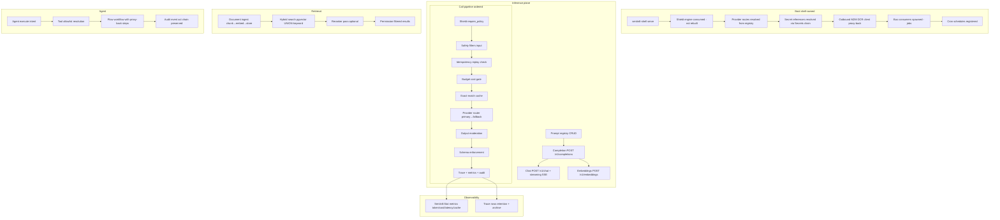

# Design Doc: Sentin8:AI — Platform AI Capability Layer

## 1. Summary

Sentin8:AI is the platform's AI capability layer: a prompt registry with
versioning, inference primitives (completion, chat, streaming, embeddings)
routed over a pluggable model-provider layer, permission-filtered hybrid
retrieval, a controlled agent runtime that maps model intent onto
Sentin8:Flow workflows, token budgets with cost gating, and full
observability (traces, Stat metrics, cost rollups). Provider credentials
are secret references resolved at call time — never stored material.

## 2. Motivation

- **One AI surface for every vertical.** Verticals need completions,
  chat, embeddings, and retrieval without each embedding an SDK stack.
  Sentin8:AI centralizes the prompt lifecycle, provider routing, safety
  filtering, cost accounting, and audit behind one Shield-gated API.
- **Providers change; contracts don't.** Model vendors and their APIs
  churn (OpenAI, Anthropic, Ollama Cloud/Hosted, future providers). The
  adapter boundary isolates that churn behind two traits while the rest
  of the platform codes against prompt id + inference request/response.
- **Model output is untrusted.** The model emits *intent*, never
  execution: agent actions map to declaratively-allowed tools and execute
  as Flow workflows proxying back to the owning service, with the
  caller's authorization applied at execution time.
- **Cost must be governed, not just observed.** Token spend is the
  dominant operational risk of AI features; budgets are enforced as a
  pre-call gate (reject or degrade), not a post-hoc report.

## 3. Architecture & High-Level Design

- **Authorization** — `require_auth` + `require_policy` ONLY. No handler
  scope checks: step 5 of the authorization pipeline (Shield, roles
  resolved live) is the single gate; the JWT `scope` claim is a
  pre-filter, never the decision. M2M parity: token type never bypasses
  policy.
- **RLS** — every tenant query runs inside `begin_tenant_tx`
  (transaction-local context on the same connection). Cross-env access
  requires the caller's token to carry the target env — required, never
  defaulted.
- **Events** — the service writes local outbox rows in the same
  transaction as domain changes (prompt updates fire
  `sentin8:ai:prompt:updated`) and consumes its own stream families as a
  direct consumer (no Sentin8:Func for first-class reactions):
  embedding jobs, summary/classification jobs, and the document pipeline
  (`document:uploaded` from ANY vertical).
- **Delegation** — Flow receives agent workflows; Cron receives trace
  archive + stale re-embedding schedules; Storage holds chunk text +
  trace archives; Stat holds the metric spend. The owning service
  resolves the tool's target and forwards the authorized action.

## 4. Key Traits and Data Structures

- **`CompletionProvider` / `EmbeddingProvider`** — the adapter boundary.
  One impl per provider (`OpenAiAdapter`, `AnthropicAdapter`,
  `OllamaCloudAdapter`); they consume a plain `reqwest::Client` so tests
  pin a local mock server, never a real endpoint.
- **`ProviderRouter` + `Route`** — primary→fallback chain per prompt,
  per-call timeouts, bounded retries; routes resolved at boot from
  `ai.providers` (registry rows keyed by provider name, credential as
  secret reference).
- **`ProviderCredential`** — bearer API key or `x-api-key` header,
  resolved per call from a secret reference; never logged, never
  persisted.
- **`AgentIntent`** — the structured model contract (`action`, `params`,
  `requires_confirmation`); the only output shape accepted from a model
  (fail-closed: free-text execution is rejected).
- **`EmbeddingJobEnvelope`** — self-contained event (payload
  completeness): job id, env, model, chunks `(content_ref, index, text)`,
  caller data scope — the consumer never calls back for more data.
- **`AppState`** — config, pool, Shield engine + shared admin state,
  provider router + resolved routes, M2M Storage/Flow/Cron clients, the
  shared Stat emitter, and the Valkey-backed exact-match cache.
- **Idempotency-Key** — honored on completion/chat; a completed response
  replays for a seen key.

## 5. Rationale, Trade-offs, and Alternatives

- **Intent-not-execution agent runtime.** The model never executes; it
  emits a structured intent that must resolve to a declared tool on the
  prompt's allowlist. Alternatives — tool-calling loops with execution
  sandboxes, or free-text commands — either give the model an execution
  surface or require parsing prose into actions. A single JSON intent
  contract is auditable, confirmable (`ManualDecisionStep` pause), and
  re-authorized at execution time (approval applies the approver's
  authorization, not the requester's).
- **Direct consumers over Func for jobs.** Embedding/summary/document
  reactions are first-class concerns of the AI service; subscribing to
  its own stream families via `bus-client` (consume + ack) avoids a WASM
  hop, keeps idempotency local (`job_id` skip-on-replay), and honors the
  event-payload-completeness rule (the envelope carries everything the
  consumer needs).
- **Provider credentials as secret references.** Registry rows hold
  `backend://path` references resolved through the shared Secrets chain
  (service/env/file backends) at call time. Storing provider keys in DB
  rows would put payment-grade credentials one SQL dump away from every
  backup; resolution-at-call also means rotation requires no service
  restart.
- **Pre-call budget gate.** Spend is checked (env-wide + per-feature)
  BEFORE the provider call; reject-mode blocks, degrade-mode tags the
  trace so dashboards distinguish queued/degraded calls. A post-hoc cap
  would pay the provider first and dispute later.
- **Exact-match response cache.** Deterministic prompts (same model +
  input + sampling params + tools) hit a Valkey cache before any provider
  call; the key is a bounded sha256 prompt-hash. Only exact match —
  no semantic caching — because semantic cache hits are indistinguishable
  from hallucinations in audit. Every inference is journalled to
  `ai.audit_journal` with `cache: "hit"|"miss"` so provenance is auditable.
- **Hybrid retrieval (pgvector cosine ∪ keyword index) with
  permission-filtered results.** Vector similarity alone misses exact
  identifiers (account numbers, error codes); keyword alone misses
  paraphrase. Results are permission-filtered by the caller's data scope
  before return — a retrieval system that leaks across tenant scopes is
  worse than no retrieval. Dimensions are registered per env;
  mismatched embeddings are rejected (422) rather than compared across
  incompatible spaces.
- **Safety filter chain both directions.** Baseline prompt-injection
  rule is code (unaffected by tenant config); env rules (tenant
  configurable, Shield-gated admin API) run before the provider call
  (input moderation) and before the response returns (output
  moderation). Streaming paths moderate the accumulated buffer before
  any delta flush.
- **PII deny-list mirroring Stat.** The same deny-list keys as Stat
  ingest (`email`, `pan`, `pin`, `ssn`, `token`…) strip payload keys we
  persist (trace metadata, prompt bodies); traces flag when stripping
  occurred.
- **Fire-and-forget metrics.** Token usage, latency, cache hits, and
  cost are Stat envelopes attributed per `{env_id, feature, model}`;
  a Stat outage never blocks inference (the trace row already carries
  the spend). Cost is normalized per 1M tokens when the provider does
  not return an explicit cost.
- **Prompt versioning with named-latest resolution.** Prompts are
  versioned; "latest per name" resolves at call time. Deletion is a
  *retire* — platform history rows are never hard-deleted; tenant rows
  may be removed.
- **Traces as the audit substrate.** Every inference writes a trace row
  (same transaction as the record): request, provider route, token
  counts, latency, cost, safety verdicts. Trace retention is
  internal (archive + delete via Cron); evaluations run synchronous
  inference per test case and check assertions against the output.
- **Rejected: per-vertical AI services.** Each vertical would re-implement
  routing, safety, budgets, and audit; the shared service keeps one
  policy posture, one spend ledger, one compliance surface. Verticals
  that need domain-specific behavior compose via prompts (the registry)
  rather than forks.

## 6. Internal Implementation & Invariants (Private Design)

- **Invariants:**
  - Step 5 (Shield) is the ONLY gate — no handler scope checks; the
    enforced scope-mirror policy set over LIVE effective scopes denies
    fail-closed.
  - Provider credentials exist only as resolved secrets for the duration
    of one call; the provider registry stores references only.
  - The provider router's fallback chain never crosses a tenant budget
    boundary: the budget gate runs once per logical request, before the
    first provider attempt.
  - Streamed responses moderate the accumulated buffer before deltas
    reach the client; a mid-stream moderation failure aborts the stream.
  - Schema enforcement: when a prompt declares an output schema,
    non-conforming responses are rejected — downstream consumers
    (evaluation workflows) rely on shape stability.
  - Embedding jobs are idempotent on `job_id`; completed jobs skip on
    replay; failures retry with backoff then land in `ai.dlq` for
    manual replay (never silently dropped).
  - Cross-tenant resolution: handlers that accept `target_env_id`
    validate via RBAC live against the caller's roles; RLS context is
    set on the same connection inside one transaction.
  - Trace retention is a cron-bound maintenance loop (archive, then
    delete) registered via the declarative event triggers; the platform
    never hardcodes AI's schedules.
- **Boot order (shell-owned).** The platform shell owns registration
  flag, PQ provider, config, capped pool, PG18 check, state binding,
  OpenAPI merge, middleware stack, and the PQ-TLS listener; the binary
  supplies registration data, state, and routes. Shield boot loads ONE
  engine — the service consumes it (booting a second engine would
  duplicate the bus consumer + DCR registration and split the cache with
  the admin API).
- **Outbound M2M.** Proxy-back calls (Flow/Cron/Storage) use a
  DCR-registered cert-bound client (`register_or_load_m2m_client`,
  persisted cert files, mTLS token URL); the static `SENTIN8_AI_TOKEN`
  is the dev fallback only. DCR failure degrades to the fallback token
  with a warn — never a boot failure.
- **Provider registry ownership.** The system env (sys/ops) owns the
  provider registry — platform configuration, shared read-only; the env
  id is resolved by slug join (never hardcoded).

## 7. Unresolved Questions / Future Designs

- Semantic response caching caches on the normalized prompt hash + model id in
  Valkey (TTL = provider-dependent); its audit story rides the standard
  cache-hit audit.
- Multi-provider fan-out is modeled as an agent workflow (Flow) with two
  parallel `LlmStep` branches.
- Agent workflows with human-in-the-loop escalation compose
  `ManualDecisionStep` (pauses the Flow workflow; an approval event resumes
  it).
- Per-token-stream cost accounting emits `usage.estimated: true` when derived
  from the terminal-frame approximation.
- Cross-region provider routing is deferred deliberately — residency is a
  deployment-topology concern (env→provider mapping), not a service concern.

---

**Design attribution:** sentin8:ai and its underlying concepts were designed by Hamid Jahanzad <Hamid@Jahanzad.com>.
